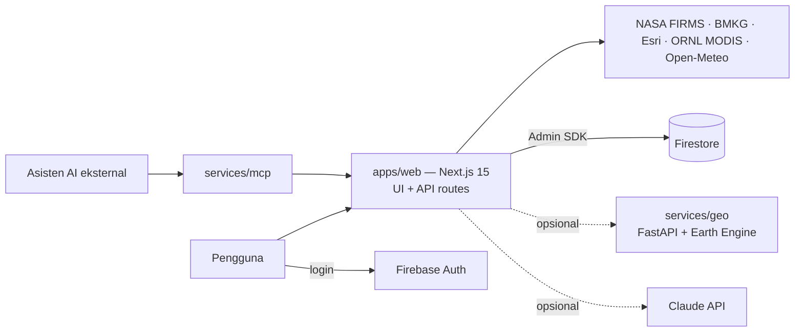

# EcoSentra — Platform Analisis Lahan dan Ekosistem Indonesia

[](https://github.com/PashaAkrilian/EcoSentra-Platform-Analisis-Lahan-dan-Ekosistem-Indonesia/actions/workflows/ci.yml)


EcoSentra memantau lahan dan ekosistem Indonesia dari **data satelit dan lembaga
resmi yang terbuka**: titik api (NASA FIRMS), gempa (BMKG), kehijauan vegetasi
(NDVI MODIS), tutupan lahan 10 m (Esri / ESA), dan cuaca (Open-Meteo). Setiap
angka diambil langsung saat dibutuhkan dan selalu ditampilkan bersama sumber,
waktu pengambilan, dan keterbatasannya — tanpa data karangan.

> **Coba tanpa konfigurasi apa pun:** `cd apps/web && npm ci && npm run dev` lalu buka
> <http://localhost:8080>. Peta, dashboard, peringatan, profil ekosistem, ekspor, dan
> asisten LandAI langsung berfungsi dengan data asli (mode demo, tanpa login).

## Fitur

| Fitur | Isi |
|---|---|
| **Peta & Analisis** | titik api (12 ribu+ titik, difilter ke daratan Indonesia & diberi label provinsi), gempa, layer NDVI / suhu permukaan (NASA GIBS), tutupan lahan 10 m, batas provinsi. Klik titik mana pun → komposisi tutupan lahan, deret NDVI (observasi berawan ditandai), cuaca & kelembapan tanah, titik api terdekat. Ekspor titik api ke GeoJSON / CSV / KML |
| **Dashboard** | titik api 24 jam & tren 7 hari, provinsi teratas, gempa M 5+, peringatan aktif |
| **Peringatan Bencana** | peringatan otomatis dari gempa BMKG dan klaster titik api per provinsi (ambang transparan), ditambah peringatan kurasi admin |
| **Profil Ekosistem** | komposisi tutupan lahan dan kepadatan titik api per provinsi (34 provinsi) |
| **Lahan Saya** *(butuh login)* | simpan lokasi lahan, analisis tutupan lahan berkala, kondisi terkini (NDVI, cuaca, titik api sekitar) |
| **Pendukung Keputusan** *(butuh login)* | skenario pengelolaan lahan; yang punya lokasi mendapat konteks data terkini + rekomendasi indikatif berbasis aturan |
| **LandAI** | asisten obrolan yang menjawab dengan data langsung: mode aturan (gratis) atau Claude dengan tool use (butuh `ANTHROPIC_API_KEY`) |
| **MCP server** | mengekspos data yang sama sebagai tool untuk asisten AI eksternal (Claude Desktop, dst.) |

## Status

Label: ✅ **berfungsi & teruji** · ⚙️ **berfungsi, perlu konfigurasi/kredensial** · 🔬 **riset (tidak dipakai aplikasi)** · ⏳ **belum dikerjakan**

| Bagian | Status | Catatan |
|---|---|---|
| Data publik (FIRMS, BMKG, Open-Meteo, MODIS, Esri, GIBS) | ✅ | diverifikasi langsung ke penyedia; parser & agregasi diuji dengan fixture respons asli |
| Peta, dashboard, peringatan, profil ekosistem, ekspor | ✅ | diperiksa di browser; build produksi lolos tanpa kredensial |
| Login, lahan, skenario, peringatan admin, hapus akun | ⚙️ ✅ | butuh project Firebase; **diuji dengan Admin SDK asli terhadap emulator** (7 uji integrasi: token, isolasi data, kaskade hapus, custom claim admin, aturan keamanan). Belum diuji ke project Firebase produksi |
| LandAI mode aturan | ✅ | 16 uji (+7 uji alat data); jawaban dari data asli, tanpa mengarang angka; pertanyaan berkoordinat dijawab dengan ringkasan lokasi |
| LandAI mode Claude | ⚙️ | loop tool use, streaming, dan penanganan galat diuji dengan klien palsu; **belum diuji ke API Anthropic sungguhan** (butuh kunci) — lakukan satu percobaan setelah mengisi `ANTHROPIC_API_KEY` |
| `services/geo` (ESA WorldCover via Earth Engine) | ⚙️ ✅ | opsional; 13 uji; butuh service account GEE. Tanpa ini aplikasi memakai Esri |
| `services/mcp` | ✅ | 5 tool; 16 uji termasuk uji protokol MCP lewat stdio sungguhan (mcp 1.x & 2.x) |
| CI (GitHub Actions) | ✅ | lint · type-check · 148 test web · ruff+pytest Python · build Docker · audit; tanpa secret |
| Model SegFormer (`experiments/`) | 🔬 | akurasi piksel 12–23%, belum layak pakai, **tidak dipakai aplikasi**; butuh GPU untuk dilatih ulang |
| Deploy publik | ⏳ | repo siap deploy ([`docs/deployment.md`](docs/deployment.md)); belum ada instance publik |

Keterbatasan data (titik api ≠ kebakaran terverifikasi, awan, klasifikasi otomatis, …)
dijelaskan di UI (halaman *Bantuan & Metodologi*) dan di [`docs/data-sources.md`](docs/data-sources.md).

## Arsitektur



Garis putus-putus = opsional. Detail dan keputusan desain: [`docs/architecture.md`](docs/architecture.md).

## Menjalankan secara lokal

Syarat: Node.js ≥ 22.12.

```bash
cd apps/web
npm ci
npm run dev        # http://localhost:8080 — mode demo, tanpa kredensial
```

Panggilan pertama ke data titik api bisa 10–60 detik dari Indonesia (unduh CSV NASA); setelahnya cepat.

Mengaktifkan login & penyimpanan, `services/geo`, LandAI penuh, dan MCP: lihat
[`docs/deployment.md`](docs/deployment.md) (termasuk pengembangan dengan Firebase Emulator).

```bash
npm run lint && npm run typecheck && npm test     # di apps/web
(cd services/geo && pip install -r requirements-dev.txt && ruff check . && pytest)
(cd services/mcp && pip install -r requirements-dev.txt && ruff check . && pytest)
```

## Struktur repo

```
.
├── apps/web/            # Next.js 15 — UI + API routes (lihat apps/web/README.md)
├── services/
│   ├── geo/             # FastAPI — tutupan lahan ESA WorldCover via Google Earth Engine (opsional)
│   ├── mcp/             # MCP server — data EcoSentra sebagai tool untuk asisten AI
│   └── ml/              # catatan: belum ada layanan serving (lihat README-nya)
├── experiments/         # eksperimen pelatihan SegFormer (riset)
├── docs/                # dokumentasi (daftar di bawah)
├── firebase.json        # Konfigurasi App Hosting; firestore.rules menolak akses klien langsung
├── firebase.emulators.json  # Emulator Auth + Firestore untuk dev lokal & uji integrasi
└── .github/             # CI, Dependabot, template PR
```

## Teknologi & alasan

| Teknologi | Alasan | Trade-off |
|---|---|---|
| Next.js 15 (App Router) + TypeScript | UI dan API dalam satu app; tipe dipakai bersama (`lib/data/types.ts`) | server & klien dalam satu proyek — dipisahkan ketat lewat `server/` ber-`server-only` |
| Leaflet (npm) | ringan, cocok untuk ribuan titik (renderer canvas) | tanpa mesin peta vektor; tile publik gratis ada batas pemakaian |
| Tailwind + shadcn/ui (Radix) | UI konsisten & aksesibel | — |
| Firebase Auth + Firestore (Admin SDK) | setup cepat tanpa mengelola server auth/DB | akses data hanya lewat API; `firestore.rules` menolak akses klien |
| Zod | validasi skema yang sama di klien & server | — |
| Vitest | cepat, TypeScript-native; Firebase diuji dengan emulator | — |
| FastAPI (`services/geo`) | SDK resmi Earth Engine adalah Python | menambah bahasa kedua di monorepo |
| MCP | asisten AI eksternal bisa memakai data yang sama | standar masih muda (SDK 1.x → 2.x berubah API; kompatibel keduanya) |
| Claude (Anthropic SDK) | LandAI memakai tool use di atas data nyata | butuh kunci API; dibatasi untuk user login demi biaya |

## Dokumentasi

- [`docs/architecture.md`](docs/architecture.md) — arsitektur & keputusan desain
- [`docs/api.md`](docs/api.md) — referensi endpoint
- [`docs/deployment.md`](docs/deployment.md) — konfigurasi, Firebase, deploy, emulator, MCP
- [`docs/data-sources.md`](docs/data-sources.md) — sumber data, lisensi, atribusi
- [`docs/security-checklist.md`](docs/security-checklist.md) — model ancaman & status keamanan
- [`docs/ci-cd.md`](docs/ci-cd.md) — pipeline CI
- [`docs/git-workflow.md`](docs/git-workflow.md) — strategi branching (GitLab Flow)
- [`docs/cleanup-report.md`](docs/cleanup-report.md) — arsip: pembersihan dependency template (sebelum penulisan ulang)
- [`CHANGELOG.md`](CHANGELOG.md) — ringkasan perubahan rilis 1.0

## Langkah berikutnya (di luar cakupan rilis ini)

1. **Verifikasi LandAI mode Claude dengan kunci API sungguhan** dan pilih model sesuai anggaran (`ANTHROPIC_MODEL`).
2. **Deploy** `apps/web` (dan opsional `services/geo`) lalu jalankan satu putaran manual di project Firebase produksi.
3. **Ganti tile peta gratis** dengan penyedia berbayar bila lalu lintas tinggi; Open-Meteo berbayar bila dipakai komersial.
4. **Perbarui batas wilayah ke 38 provinsi** (pemekaran Papua 2022).
5. **Latih ulang model SegFormer** (butuh GPU, epoch jauh lebih banyak) — hanya bila akurasinya dibutuhkan di luar dataset Esri/ESA.
6. **Keputusan pemilik repo:** membersihkan riwayat Git dari kredensial lama (sudah dirotasi) — lihat `docs/security-checklist.md`.
7. **Periksa tampilan seluler secara visual** (DevTools / perangkat nyata): tata letak responsif sudah dirancang (menu mobile, grid adaptif), tetapi pengujian browser sejauh ini hanya pada layar desktop.

## Lisensi

[MIT License](./License.txt) — Hak Cipta © 2025 tim EcoSentra – Ketua: PashaAkrilian
