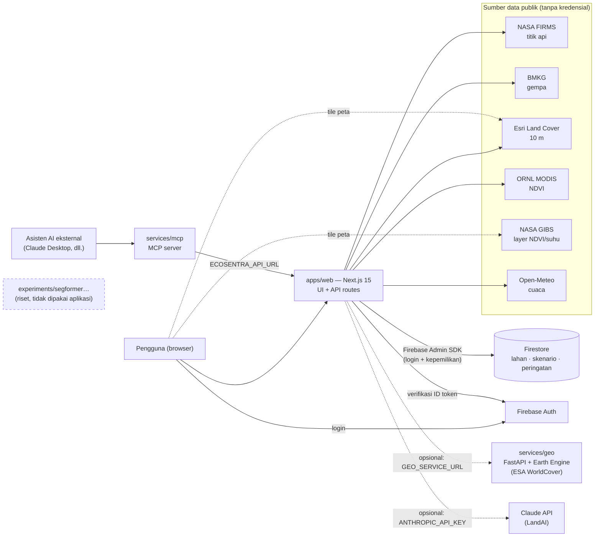

# Arsitektur EcoSentra

## Gambaran besar



Garis putus-putus = integrasi opsional. Tanpa konfigurasi apa pun aplikasi tetap
berjalan dalam **mode demo**: semua data publik berfungsi; login dan penyimpanan
data pribadi nonaktif.

## Komponen

| Komponen | Peran | Teknologi |
|---|---|---|
| `apps/web` | UI, API routes, akses data eksternal & Firestore | Next.js 15 (App Router), React 19, TypeScript, Tailwind, Leaflet, Zod |
| `services/geo` | Tutupan lahan ESA WorldCover lewat Google Earth Engine (opsional) | FastAPI, earthengine-api, slowapi |
| `services/mcp` | Mengekspos data EcoSentra sebagai tool MCP untuk asisten AI eksternal | MCP Python SDK, httpx |
| `experiments/` | Eksperimen pelatihan SegFormer (riset) | PyTorch / Hugging Face (di luar repo: bobot model) |

## Struktur `apps/web`

```
app/
  (app)/…            halaman berlayout aplikasi: dashboard, maps, fields, disaster-alerts,
                     ecosystem, decision-support, settings, help
  login/             halaman login/daftar (layout sendiri)
  api/…              route handlers (lihat docs/api.md)
components/          UI: app-shell, charts/, map/, fields/, decisions/, alerts/, chat/, ui/ (shadcn)
hooks/               use-api (fetch + state), use-hotspots, use-location-data, use-chat
lib/                 kode yang aman dipakai klien: tipe, skema Zod, format, geo, alerts,
                     recommendations, ndvi, map/layers, provinces
server/              HANYA server ("server-only"): sumber data, cache, rate limit, auth,
                     Firestore, asisten (tools/rules/claude)
  sources/           firms · bmkg · openMeteo · modisNdvi · landcover · provinceLandcover
  geo/               poligon provinsi + klasifikasi titik→provinsi
  assistant/         tools (dipakai 2 mode) · rules · claude
tests/               Vitest: server/, api/, assistant/, lib/
```

Aturan batas: file di `server/` mengimpor `"server-only"` — kalau komponen klien
mengimpornya, build gagal. Kode di `lib/` tidak boleh mengimpor dari `server/`.

## Keputusan desain penting

**1. Data nyata di server, bukan di browser.** Browser hanya memanggil API
kita; semua akses ke NASA/BMKG/Esri/ORNL/Open-Meteo dari server. Alasannya:
CORS, cache bersama (CSV FIRMS 1–6 MB dipakai ribuan pengguna), rate limit
terpusat, dan pemfilteran (titik api → daratan Indonesia + provinsi) dilakukan
sekali, bukan di tiap klien.

**2. Cache stale-while-revalidate** (`server/cache.ts`). Sumber seperti CSV FIRMS
bisa butuh 5–60 detik dari Indonesia. Setelah panggilan pertama, pengguna
selalu mendapat nilai lama langsung sementara pembaruan berjalan di latar
belakang; kalau sumber sedang gagal, data lama tetap dipakai. Cache dipanaskan saat
server start (`instrumentation.node.ts`). Cache bersifat per-instance — untuk
multi-instance dengan beban tinggi, ganti dengan Redis/CDN.

**3. Titik api diklasifikasi ke provinsi dengan poligon sungguhan**
(point-in-polygon pada batas geoBoundaries yang disederhanakan, dengan bbox
per poligon sebagai prefilter), bukan kotak koordinat kasar. Validasi: selisih
< 0,1% terhadap data tanpa penyederhanaan.

**4. Firestore hanya diakses lewat server.** Browser memakai Firebase hanya
untuk Auth. Semua baca/tulis data lewat API routes memakai Admin SDK, yang
memverifikasi ID token dan memeriksa kepemilikan (`server/auth.ts`,
`server/firestore.ts`). `firestore.rules` menolak semua akses klien langsung,
sehingga API key web (yang publik) tidak bisa dipakai membaca data.

**5. Dua mode untuk LandAI dengan alat yang sama.** `server/assistant/tools.ts`
mendefinisikan alat data sekali; mode Claude memanggilnya lewat tool use, mode
aturan memanggilnya langsung dan menyusun teks dari hasilnya. Mode aturan tidak
pernah mengarang angka — tanpa kunci API fitur tetap berguna dan gratis. Mode
Claude dibatasi untuk pengguna login (kalau Firebase aktif) demi melindungi biaya.

**6. Tanpa data karangan.** Setiap tampilan data mencantumkan sumber & waktu;
kalau sumber gagal, UI menampilkan galat dengan tombol coba-lagi, bukan angka
cadangan. Satu-satunya "mock" yang tersisa adalah mode contoh `get_land_cover`
di MCP server, yang ditandai `[MOCK]` di keluarannya.

**7. Peringatan = ambang transparan.** `lib/alerts.ts` mengubah gempa BMKG dan
jumlah titik api per provinsi menjadi tingkat keparahan dengan ambang yang
tertulis di kode, di halaman Bantuan, dan diuji unit. Ini prioritisasi tampilan,
bukan pengganti peringatan resmi.

## Visualisasi

Palet grafik mengikuti metode warna-berdasarkan-fungsi: satu warna entitas
konsisten di semua grafik (oranye = titik api, hijau = vegetasi, biru = air,
ungu = gempa), teks tidak pernah memakai warna data, status selalu berikon +
teks, setiap grafik punya padanan tabel ("Lihat sebagai tabel"), kolom tidak
lengkap (hari berjalan) digambar pucat, dan observasi berawan pada NDVI
digambar berongga tanpa disambung garis.

## Batasan yang diketahui

- Cache & rate limit in-memory (per instance) — cukup untuk satu instance, perlu
  penyimpanan bersama untuk skala horizontal.
- 34 provinsi (data 2017); pemekaran Papua 2022 belum tercermin.
- Model SegFormer (akurasi piksel 12–23%) belum layak pakai dan tidak dipakai
  aplikasi; tutupan lahan memakai dataset Esri/ESA. Melatih ulang butuh GPU.
- Open-Meteo gratis hanya untuk non-komersial; tile peta gratis ada batas pemakaian
  (lihat [`data-sources.md`](./data-sources.md)).
